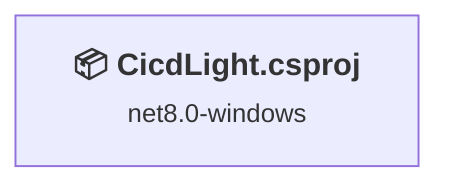
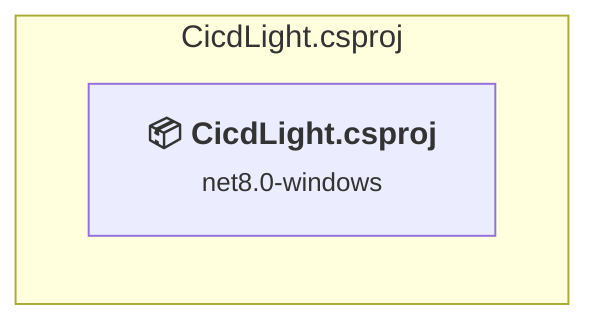

# Projects and dependencies analysis

This document provides a comprehensive overview of the projects and their dependencies in the context of upgrading to .NETCoreApp,Version=v10.0.

## Table of Contents

- [Executive Summary](#executive-Summary)
  - [Highlevel Metrics](#highlevel-metrics)
  - [Projects Compatibility](#projects-compatibility)
  - [Package Compatibility](#package-compatibility)
  - [API Compatibility](#api-compatibility)
  - [Binding Redirect Configuration](#binding-redirect-configuration)
- [Aggregate NuGet packages details](#aggregate-nuget-packages-details)
- [Top API Migration Challenges](#top-api-migration-challenges)
  - [Technologies and Features](#technologies-and-features)
  - [Most Frequent API Issues](#most-frequent-api-issues)
- [Projects Relationship Graph](#projects-relationship-graph)
- [Project Details](#project-details)

  - [CicdLight.csproj](#cicdlightcsproj)

## Executive Summary

### Highlevel Metrics

| Metric | Count | Status |
| :--- | :---: | :--- |
| Total Projects | 1 | All require upgrade |
| Total NuGet Packages | 1 | All packages need upgrade |
| Total Code Files | 6 |  |
| Total Code Files with Incidents | 7 |  |
| Total Lines of Code | 655 |  |
| Total Number of Issues | 615 |  |
| Estimated LOC to modify | 613+ | at least 93,6% of codebase |

### Projects Compatibility

| Project | Target Framework | Difficulty | Package Issues | API Issues | Binding Issues | Est. LOC Impact | Description |
| :--- | :---: | :---: | :---: | :---: | :---: | :---: | :--- |
| [CicdLight.csproj](#cicdlightcsproj) | net8.0-windows | 🟡 Medium | 1 | 613 | 0 | 613+ | WinForms, Sdk Style = True |

### Package Compatibility

| Status | Count | Percentage |
| :--- | :---: | :---: |
| ✅ Compatible | 0 | 0,0% |
| ⚠️ Incompatible | 0 | 0,0% |
| 🔄 Upgrade Recommended | 1 | 100,0% |
| ***Total NuGet Packages*** | ***1*** | ***100%*** |

### API Compatibility

| Category | Count | Impact |
| :--- | :---: | :--- |
| 🔴 Binary Incompatible | 559 | High - Require code changes |
| 🟡 Source Incompatible | 47 | Medium - Needs re-compilation and potential conflicting API error fixing |
| 🔵 Behavioral change | 7 | Low - Behavioral changes that may require testing at runtime |
| ✅ Compatible | 1535 |  |
| ***Total APIs Analyzed*** | ***2148*** |  |

## Aggregate NuGet packages details

| Package | Current Version | Suggested Version | Projects | Description |
| :--- | :---: | :---: | :--- | :--- |
| System.Security.Cryptography.ProtectedData | 8.0.0 | 10.0.14 | [CicdLight.csproj](#cicdlightcsproj) | NuGet package upgrade is recommended |

## Top API Migration Challenges

### Technologies and Features

| Technology | Issues | Percentage | Migration Path |
| :--- | :---: | :---: | :--- |
| Windows Forms | 559 | 91,2% | Windows Forms APIs for building Windows desktop applications with traditional Forms-based UI that are available in .NET on Windows. Enable Windows Desktop support: Option 1 (Recommended): Target net9.0-windows; Option 2: Add <UseWindowsDesktop>true</UseWindowsDesktop>; Option 3 (Legacy): Use Microsoft.NET.Sdk.WindowsDesktop SDK. |
| GDI+ / System.Drawing | 35 | 5,7% | System.Drawing APIs for 2D graphics, imaging, and printing that are available via NuGet package System.Drawing.Common. Note: Not recommended for server scenarios due to Windows dependencies; consider cross-platform alternatives like SkiaSharp or ImageSharp for new code. |
| Windows Forms Legacy Controls | 2 | 0,3% | Legacy Windows Forms controls that have been removed from .NET Core/5+ including StatusBar, DataGrid, ContextMenu, MainMenu, MenuItem, and ToolBar. These controls were replaced by more modern alternatives. Use ToolStrip, MenuStrip, ContextMenuStrip, and DataGridView instead. |

### Most Frequent API Issues

| API | Count | Percentage | Category |
| :--- | :---: | :---: | :--- |
| M:System.Windows.Forms.Control.ControlCollection.Add(System.Windows.Forms.Control) | 30 | 4,9% | Binary Incompatible |
| T:System.Windows.Forms.DialogResult | 25 | 4,1% | Binary Incompatible |
| T:System.Windows.Forms.ContextMenuStrip | 20 | 3,3% | Binary Incompatible |
| T:System.Windows.Forms.TableLayoutControlCollection | 20 | 3,3% | Binary Incompatible |
| P:System.Windows.Forms.TableLayoutPanel.Controls | 20 | 3,3% | Binary Incompatible |
| T:System.Windows.Forms.CheckBox | 18 | 2,9% | Binary Incompatible |
| T:System.Windows.Forms.TextBox | 18 | 2,9% | Binary Incompatible |
| T:System.Windows.Forms.NotifyIcon | 16 | 2,6% | Binary Incompatible |
| T:System.Windows.Forms.ToolStripItemCollection | 14 | 2,3% | Binary Incompatible |
| P:System.Windows.Forms.ToolStrip.Items | 14 | 2,3% | Binary Incompatible |
| T:System.Drawing.Icon | 10 | 1,6% | Source Incompatible |
| T:System.Windows.Forms.Control.ControlCollection | 10 | 1,6% | Binary Incompatible |
| P:System.Windows.Forms.Control.Controls | 10 | 1,6% | Binary Incompatible |
| T:System.Windows.Forms.Label | 10 | 1,6% | Binary Incompatible |
| M:System.Windows.Forms.Label.#ctor | 10 | 1,6% | Binary Incompatible |
| T:System.Windows.Forms.FlowDirection | 9 | 1,5% | Binary Incompatible |
| T:System.Windows.Forms.FormBorderStyle | 9 | 1,5% | Binary Incompatible |
| T:System.Windows.Forms.FormStartPosition | 9 | 1,5% | Binary Incompatible |
| P:System.Windows.Forms.CheckBox.Checked | 9 | 1,5% | Binary Incompatible |
| P:System.Windows.Forms.TextBox.Text | 9 | 1,5% | Binary Incompatible |
| T:System.Windows.Forms.Padding | 8 | 1,3% | Binary Incompatible |
| T:System.Windows.Forms.ToolTipIcon | 7 | 1,1% | Binary Incompatible |
| T:System.Windows.Forms.Timer | 6 | 1,0% | Binary Incompatible |
| T:System.Windows.Forms.IButtonControl | 6 | 1,0% | Binary Incompatible |
| T:System.Windows.Forms.DockStyle | 6 | 1,0% | Binary Incompatible |
| P:System.Windows.Forms.ButtonBase.AutoSize | 6 | 1,0% | Binary Incompatible |
| P:System.Windows.Forms.Button.DialogResult | 6 | 1,0% | Binary Incompatible |
| P:System.Windows.Forms.ButtonBase.Text | 6 | 1,0% | Binary Incompatible |
| T:System.Windows.Forms.Button | 6 | 1,0% | Binary Incompatible |
| M:System.Windows.Forms.Button.#ctor | 6 | 1,0% | Binary Incompatible |
| T:System.Windows.Forms.ToolStripItem | 6 | 1,0% | Binary Incompatible |
| M:System.Windows.Forms.ToolStripItemCollection.Add(System.String,System.Drawing.Image,System.EventHandler) | 6 | 1,0% | Binary Incompatible |
| T:System.Windows.Forms.MouseButtons | 6 | 1,0% | Binary Incompatible |
| T:System.Windows.Forms.NumericUpDown | 6 | 1,0% | Binary Incompatible |
| T:System.Windows.Forms.AnchorStyles | 6 | 1,0% | Binary Incompatible |
| T:System.Windows.Forms.AutoSizeMode | 6 | 1,0% | Binary Incompatible |
| F:System.Windows.Forms.DialogResult.OK | 5 | 0,8% | Binary Incompatible |
| P:System.Windows.Forms.Panel.AutoSize | 5 | 0,8% | Binary Incompatible |
| M:System.Windows.Forms.ToolStripItemCollection.Add(System.Windows.Forms.ToolStripItem) | 5 | 0,8% | Binary Incompatible |
| T:System.Uri | 5 | 0,8% | Behavioral Change |
| T:System.Windows.Forms.Application | 4 | 0,7% | Binary Incompatible |
| P:System.Windows.Forms.NotifyIcon.Icon | 4 | 0,7% | Binary Incompatible |
| T:System.Windows.Forms.MouseEventHandler | 4 | 0,7% | Binary Incompatible |
| T:System.Security.Cryptography.DataProtectionScope | 4 | 0,7% | Source Incompatible |
| P:System.Windows.Forms.NotifyIcon.Visible | 3 | 0,5% | Binary Incompatible |
| T:System.Drawing.Drawing2D.SmoothingMode | 3 | 0,5% | Source Incompatible |
| P:System.Windows.Forms.Form.CancelButton | 3 | 0,5% | Binary Incompatible |
| P:System.Windows.Forms.Form.AcceptButton | 3 | 0,5% | Binary Incompatible |
| F:System.Windows.Forms.FlowDirection.RightToLeft | 3 | 0,5% | Binary Incompatible |
| P:System.Windows.Forms.FlowLayoutPanel.FlowDirection | 3 | 0,5% | Binary Incompatible |

## Projects Relationship Graph

Legend:
📦 SDK-style project
⚙️ Classic project

## Project Details

### CicdLight.csproj

#### Project Info

- **Current Target Framework:** net8.0-windows
- **Proposed Target Framework:** net10.0-windows
- **SDK-style**: True
- **Project Kind:** WinForms
- **Dependencies**: 0
- **Dependants**: 0
- **Number of Files**: 6
- **Number of Files with Incidents**: 7
- **Lines of Code**: 655
- **Estimated LOC to modify**: 613+ (at least 93,6% of the project)

#### Dependency Graph

Legend:
📦 SDK-style project
⚙️ Classic project

### API Compatibility

| Category | Count | Impact |
| :--- | :---: | :--- |
| 🔴 Binary Incompatible | 559 | High - Require code changes |
| 🟡 Source Incompatible | 47 | Medium - Needs re-compilation and potential conflicting API error fixing |
| 🔵 Behavioral change | 7 | Low - Behavioral changes that may require testing at runtime |
| ✅ Compatible | 1535 |  |
| ***Total APIs Analyzed*** | ***2148*** |  |

#### Project Technologies and Features

| Technology | Issues | Percentage | Migration Path |
| :--- | :---: | :---: | :--- |
| GDI+ / System.Drawing | 35 | 5,7% | System.Drawing APIs for 2D graphics, imaging, and printing that are available via NuGet package System.Drawing.Common. Note: Not recommended for server scenarios due to Windows dependencies; consider cross-platform alternatives like SkiaSharp or ImageSharp for new code. |
| Windows Forms Legacy Controls | 2 | 0,3% | Legacy Windows Forms controls that have been removed from .NET Core/5+ including StatusBar, DataGrid, ContextMenu, MainMenu, MenuItem, and ToolBar. These controls were replaced by more modern alternatives. Use ToolStrip, MenuStrip, ContextMenuStrip, and DataGridView instead. |
| Windows Forms | 559 | 91,2% | Windows Forms APIs for building Windows desktop applications with traditional Forms-based UI that are available in .NET on Windows. Enable Windows Desktop support: Option 1 (Recommended): Target net9.0-windows; Option 2: Add <UseWindowsDesktop>true</UseWindowsDesktop>; Option 3 (Legacy): Use Microsoft.NET.Sdk.WindowsDesktop SDK. |

