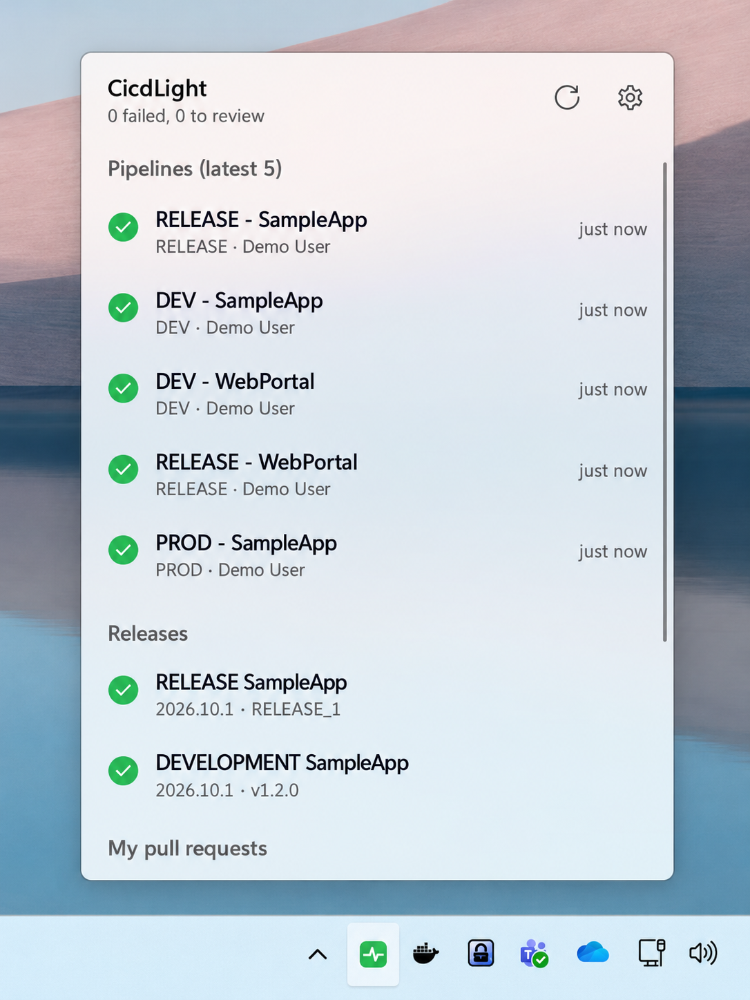

<div align="center">
  

  # CicdLight

  **Lekki monitor Azure DevOps i GitHub Actions w zasobniku systemowym Windows.**  
  **A lightweight Azure DevOps and GitHub Actions monitor for the Windows system tray.**

  .NET 10 · WinUI 3 · Windows App SDK · H.NotifyIcon

  [🇵🇱 Polski](#-polski) · [🇬🇧 English](#-english) · [Pobierz / Download](https://github.com/mateusznj/CicdLight/releases/latest)

  <a href="https://github.com/mateusznj/CicdLight/actions/workflows/build.yml"></a>
  <a href="https://github.com/mateusznj/CicdLight/releases/tag/v1.0.2"></a>
  <a href="https://github.com/mateusznj/CicdLight/releases/latest"></a>
</div>

<p align="center">
  
</p>

<p align="center"><sub>Podgląd zawiera dane demonstracyjne. / The screenshot uses demo data.</sub></p>

---

## 🇵🇱 Polski

CicdLight to niewielka aplikacja, która pozwala śledzić buildy i pull requesty w Azure DevOps oraz uruchomienia workflowów GitHub Actions bez ciągłego otwierania przeglądarki.

### Funkcje

**Ikona w zasobniku systemowym (tray):**

| Ikona | Stan | Opis |
|---|---|---|
|  | **Zielony - OK** | Brak aktywnego builda i problemów z PR-ami. |
|  | **Niebieski - build w toku** | Trwa build lub wydanie. |
|  | **Żółty - review lub komentarze** | PR oczekuje na Twoje review albo ma nierozwiązane komentarze. |
|  | **Czerwony - niepowodzenie** | Build lub wydanie zakończyło się niepowodzeniem. |
|  | **Szary - brak danych** | Brak konfiguracji lub błąd pobierania statusu. |

- **Szybki podgląd:** ostatnie buildy (pipeline + branch), wydania, PR-y Azure DevOps i GitHub oczekujące na review oraz Twoje PR-y. Przy PR-ach wyświetlana jest liczba nierozwiązanych wątków komentarzy. Kliknięcie elementu otwiera go w przeglądarce.
- **Połączenia:** lista repozytoriów GitHub i projektów Azure DevOps, każde z osobnym kluczem i wyborem obserwowanych pipeline'ów. Menu pozwala otworzyć osobno każdy skonfigurowany projekt Azure DevOps lub repozytorium GitHub. Sekret jest szyfrowany DPAPI (`CurrentUser`).
- **GitHub Actions:** statusy ostatnich uruchomień wyświetlane obok buildów Azure DevOps. Publiczne repozytoria nie wymagają tokenu; prywatne używają tokenu przypisanego do danego repozytorium.
- **GitHub pull requests:** otwarte PR-y przypisane do zalogowanego użytkownika jako autora lub osoby proszonej o review. Wymagany jest token GitHub, aby rozpoznać bieżącego użytkownika; do repozytoriów prywatnych token jest wymagany również do odczytu PR-ów.
- **Aktualizacje:** ręczne sprawdzenie najnowszego stabilnego wydania GitHub i otwarcie strony wydania; aplikacja nie pobiera ani nie instaluje aktualizacji automatycznie.
- **Powiadomienia systemowe:** globalny wyłącznik oraz ustawienia per projekt dla nieudanych i naprawionych buildów, nowych próśb o review oraz nierozwiązanych komentarzy w PR-ach. Testowy przycisk w **Ustawienia → Ogólne** pozwala sprawdzić powiadomienia Windows.
- **Ochrona tokenu PAT:** szyfrowanie DPAPI (`CurrentUser`); ustawienia zapisane w `%APPDATA%\CicdLight\settings.json`.
- **Integracja z Windows:** opcjonalny autostart oraz uruchamianie tylko jednej instancji.

### Pobieranie i instalacja

1. Przejdź do [najnowszego wydania (GitHub Releases)](https://github.com/mateusznj/CicdLight/releases/latest).
2. Pobierz odpowiedni instalator z sekcji **Assets** i uruchom go.
3. Uruchom CicdLight i otwórz **Settings**. Wybierz dostawcę, podaj organizację i projekt Azure DevOps wraz z PAT albo repozytorium GitHub wraz z opcjonalnym tokenem. Każde połączenie dodaj osobno, a potem wybierz obserwowane pipeline'y przy tym wpisie.

Do odczytu uruchomień Actions w prywatnych repozytoriach użyj fine-grained tokena z uprawnieniem **Actions: Read**. Do odczytu PR-ów token musi mieć uprawnienie **Pull requests: Read**; token jest też potrzebny do rozpoznania Twoich PR-ów i próśb o review. Dostęp do publicznych uruchomień Actions nie wymaga tokenu.

> Pliki instalacyjne znajdują się również w katalogu [`artifacts`](artifacts), ale zalecanym miejscem pobierania opublikowanych wersji jest zakładka **Releases**.

### Wymagania

- Windows 10 w wersji 1809 (build 17763) lub nowszy.
- Co najmniej jedno połączenie Azure DevOps (PAT dla danego projektu) lub repozytorium GitHub; prywatne repozytoria wymagają własnego tokenu GitHub.
- .NET 10 SDK **tylko do budowania aplikacji ze źródeł**.

### Uruchomienie ze źródeł

```powershell
dotnet run
```

Publikacja samodzielnej wersji (unpackaged, self-contained):

```powershell
dotnet publish -c Release -r win-x64 --self-contained -o publish
```

### Wymagane uprawnienia PAT

- `Build (Read)`
- `Code (Read)`
- `Release (Read)`
- `Project and Team (Read)` - potrzebne, gdy lista projektów w ustawieniach jest pusta.

Fine-grained token GitHub dla prywatnego repozytorium wymaga **Actions: Read** i **Pull requests: Read**.

### Planowane możliwości

Obsługa kolejnych scenariuszy release pipelines, work items oraz Azure Resource Health (ARM API).

---

## 🇬🇧 English

CicdLight is a lightweight Windows system tray app for monitoring Azure DevOps builds and pull requests alongside GitHub Actions workflow runs.

### Features

**System tray status:**

| Icon | Status | Description |
|---|---|---|
|  | **Green - OK** | No active builds or PR issues. |
|  | **Blue - build in progress** | A build or release is running. |
|  | **Yellow - review or comments** | A PR is awaiting your review or has unresolved comments. |
|  | **Red - failed** | A build or release has failed. |
|  | **Gray - no status** | No configuration or a status retrieval error. |

- **At-a-glance overview:** recent builds (pipeline + branch), releases, Azure DevOps and GitHub PRs awaiting review and your own PRs. Each PR shows its unresolved comment thread count. Click an item to open it in the browser.
- **Connections:** a list of GitHub repositories and Azure DevOps projects, each with its own credential and selected pipelines. The menu can open each configured Azure DevOps project or GitHub repository separately. Secrets are protected with Windows DPAPI (`CurrentUser`).
- **GitHub Actions:** recent workflow runs shown alongside Azure DevOps builds. Public repositories need no token; private repositories use a token stored on that repository's connection.
- **GitHub pull requests:** open PRs authored by the authenticated user or requesting their review. A GitHub token is required to identify the current user; private repositories also require a token to read PRs.
- **Updates:** manually checks the latest stable GitHub release and opens its release page; the app does not download or install updates automatically.
- **System notifications:** a global switch and per-project options for failed and recovered builds, new review requests, and unresolved PR comments. Use the test button in **Settings → General** to verify Windows notifications.
- **PAT protection:** Windows DPAPI encryption (`CurrentUser`); settings stored in `%APPDATA%\CicdLight\settings.json`.
- **Windows integration:** optional startup with Windows and single-instance execution.

### Download and installation

1. Open the [latest GitHub Release](https://github.com/mateusznj/CicdLight/releases/latest).
2. Download the appropriate installer from **Assets** and run it.
3. Open **Settings** and choose a provider. Add each Azure DevOps organization/project with its PAT or each GitHub repository with its optional token as a separate connection. Then choose the pipelines to monitor from that connection's row.

For private repositories, use a fine-grained token with **Actions: Read** and **Pull requests: Read** access. A token is also required to identify your own PRs and review requests. Public Actions runs can be read without a token.

> Installer files are also available in [`artifacts`](artifacts), but **Releases** is the recommended location for downloading published versions.

### Requirements

- Windows 10 version 1809 (build 17763) or later.
- At least one Azure DevOps project connection (with its PAT) or GitHub repository; private GitHub repositories require a token on that repository's connection.
- .NET 10 SDK **only if building from source**.

### Run from source

```powershell
dotnet run
```

Publish a self-contained unpackaged build:

```powershell
dotnet publish -c Release -r win-x64 --self-contained -o publish
```

### Required PAT permissions

- `Build (Read)`
- `Code (Read)`
- `Release (Read)`
- `Project and Team (Read)` - required when the project list in settings is empty.

`Work Items` is not required.

Fine-grained GitHub tokens for private repositories require **Actions: Read** and **Pull requests: Read**.

### Roadmap ideas

Additional release pipeline scenarios, work items, and Azure Resource Health (ARM API).
