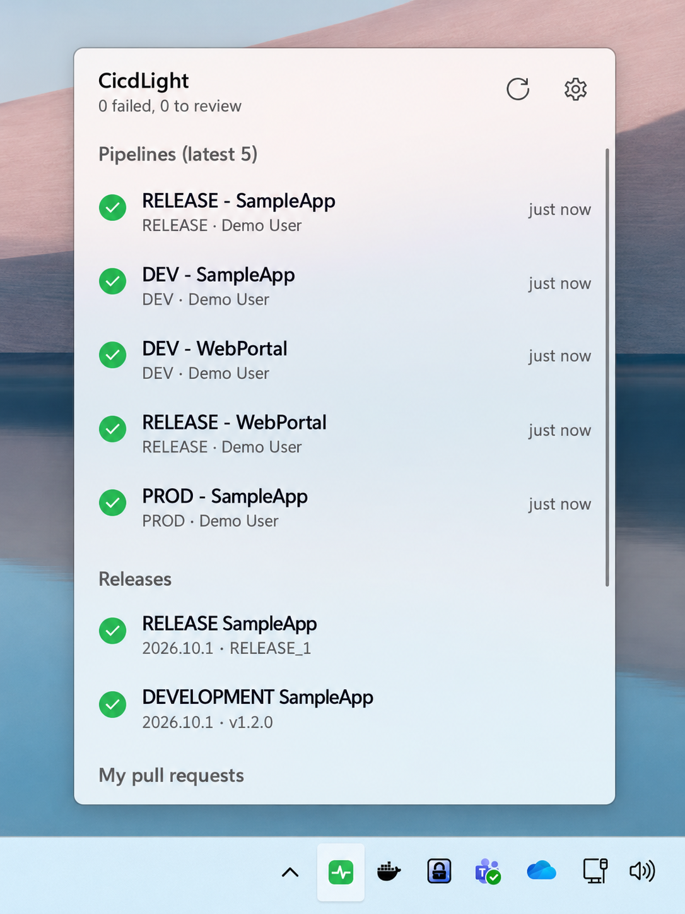

<div align="center">
  

  # CicdLight

  **Lekki monitor Azure DevOps i GitHub Actions w zasobniku systemowym Windows.**  
  **A lightweight Azure DevOps and GitHub Actions monitor for the Windows system tray.**

  .NET 10 · WinUI 3 · Windows App SDK · H.NotifyIcon

  [🇵🇱 Polski](#-polski) · [🇬🇧 English](#-english) · [Pobierz / Download](https://github.com/mateusznj/CicdLight/releases/latest)
</div>

<p align="center">
  
</p>

<p align="center"><sub>Podgląd zawiera dane demonstracyjne. / The screenshot uses demo data.</sub></p>

---

## 🇵🇱 Polski

CicdLight to niewielka aplikacja, która pozwala śledzić buildy i pull requesty w Azure DevOps oraz uruchomienia workflowów GitHub Actions bez ciągłego otwierania przeglądarki.

### Funkcje

- **Ikona w zasobniku systemowym (tray):** zielony — OK, niebieski — build w toku, żółty — PR oczekuje na Twoje review, czerwony — nieudany build, szary — błąd lub brak konfiguracji.
- **Szybki podgląd:** ostatnie buildy (pipeline + branch), wydania, PR-y oczekujące na review oraz Twoje PR-y. Kliknięcie elementu otwiera go w przeglądarce.
- **Połączenia:** lista repozytoriów GitHub i projektów Azure DevOps, każde z osobnym kluczem i wyborem obserwowanych pipeline'ów. Sekret jest szyfrowany DPAPI (`CurrentUser`).
- **GitHub Actions:** statusy ostatnich uruchomień wyświetlane obok buildów Azure DevOps. Publiczne repozytoria nie wymagają tokenu; prywatne używają tokenu przypisanego do danego repozytorium.
- **Aktualizacje:** ręczne sprawdzenie najnowszego stabilnego wydania GitHub i otwarcie strony wydania; aplikacja nie pobiera ani nie instaluje aktualizacji automatycznie.
- **Powiadomienia systemowe:** globalny wyłącznik oraz checkboxy dla nieudanych i naprawionych buildów oraz nowych próśb o review w tabeli projektów w oknie wyboru pipeline'ów.
- **Ochrona tokenu PAT:** szyfrowanie DPAPI (`CurrentUser`); ustawienia zapisane w `%APPDATA%\CicdLight\settings.json`.
- **Integracja z Windows:** opcjonalny autostart oraz uruchamianie tylko jednej instancji.

### Pobieranie i instalacja

1. Przejdź do [najnowszego wydania (GitHub Releases)](https://github.com/mateusznj/CicdLight/releases/latest).
2. Pobierz odpowiedni instalator z sekcji **Assets** i uruchom go.
3. Uruchom CicdLight i otwórz **Settings**. Wybierz dostawcę, podaj organizację i projekt Azure DevOps wraz z PAT albo repozytorium GitHub wraz z opcjonalnym tokenem. Każde połączenie dodaj osobno, a potem wybierz obserwowane pipeline'y przy tym wpisie.

Do odczytu uruchomień Actions w prywatnych repozytoriach użyj fine-grained tokena z uprawnieniem **Actions: Read** i dostępem do wybranych repozytoriów. Token dla publicznych repozytoriów jest opcjonalny.

> Pliki instalacyjne znajdują się również w katalogu [`artifacts`](artifacts), ale zalecanym miejscem pobierania opublikowanych wersji jest zakładka **Releases**.

### Wymagania

- Windows 10 w wersji 1809 (build 17763) lub nowszy.
- Co najmniej jedno połączenie Azure DevOps (PAT dla danego projektu) lub repozytorium GitHub; prywatne repozytoria wymagają własnego tokenu GitHub.
- .NET 10 SDK **tylko do budowania aplikacji ze źródeł**.

### Uruchomienie ze źródeł

```powershell
dotnet run
```

Publikacja samodzielnej wersji (unpackaged, self-contained):

```powershell
dotnet publish -c Release -r win-x64 --self-contained -o publish
```

### Wymagane uprawnienia PAT

- `Build (Read)`
- `Code (Read)`

- `Release (Read)`
- `Project and Team (Read)` — potrzebne, gdy lista projektów w ustawieniach jest pusta.

### Planowane możliwości

Obsługa kolejnych scenariuszy release pipelines, work items oraz Azure Resource Health (ARM API).

---

## 🇬🇧 English

CicdLight is a lightweight Windows system tray app for monitoring Azure DevOps builds and pull requests alongside GitHub Actions workflow runs.

### Features

- **System tray status:** green — OK, blue — build in progress, yellow — PR awaiting your review, red — failed build, gray — error or missing configuration.
- **At-a-glance overview:** recent builds (pipeline + branch), releases, PRs awaiting review and your own PRs. Click an item to open it in the browser.
- **Connections:** a list of GitHub repositories and Azure DevOps projects, each with its own credential and selected pipelines. Secrets are protected with Windows DPAPI (`CurrentUser`).
- **GitHub Actions:** recent workflow runs shown alongside Azure DevOps builds. Public repositories need no token; private repositories use a token stored on that repository's connection.
- **Updates:** manually checks the latest stable GitHub release and opens its release page; the app does not download or install updates automatically.
- **System notifications:** a global switch and per-project checkboxes for failed and recovered builds and new review requests in the pipeline selection window.
- **PAT protection:** Windows DPAPI encryption (`CurrentUser`); settings stored in `%APPDATA%\CicdLight\settings.json`.
- **Windows integration:** optional startup with Windows and single-instance execution.

### Download and installation

1. Open the [latest GitHub Release](https://github.com/mateusznj/CicdLight/releases/latest).
2. Download the appropriate installer from **Assets** and run it.
3. Open **Settings** and choose a provider. Add each Azure DevOps organization/project with its PAT or each GitHub repository with its optional token as a separate connection. Then choose the pipelines to monitor from that connection's row.

To read Actions runs in private repositories, use a fine-grained token with **Actions: Read** access to the selected repositories. A token is optional for public repositories.

> Installer files are also available in [`artifacts`](artifacts), but **Releases** is the recommended location for downloading published versions.

### Requirements

- Windows 10 version 1809 (build 17763) or later.
- At least one Azure DevOps project connection (with its PAT) or GitHub repository; private GitHub repositories require a token on that repository's connection.
- .NET 10 SDK **only if building from source**.

### Run from source

```powershell
dotnet run
```

Publish a self-contained unpackaged build:

```powershell
dotnet publish -c Release -r win-x64 --self-contained -o publish
```

### Required PAT permissions

- `Build (Read)`
- `Code (Read)`
- `Release (Read)`
- `Project and Team (Read)` — required when the project list in settings is empty.

`Work Items` is not required.

### Roadmap ideas

Additional release pipeline scenarios, work items, and Azure Resource Health (ARM API).
